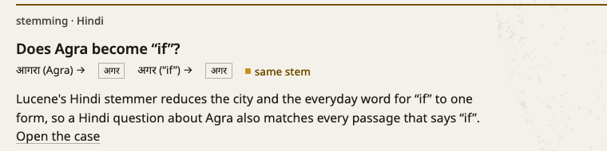
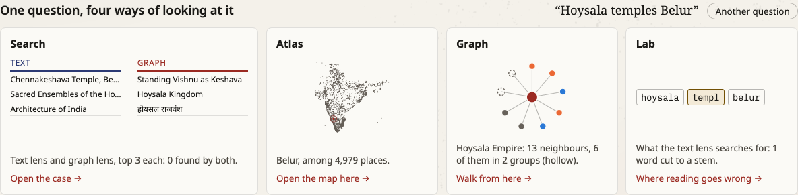
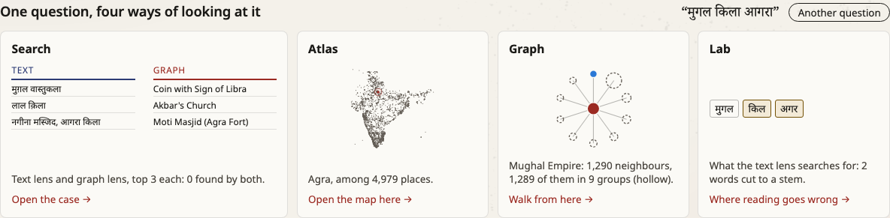
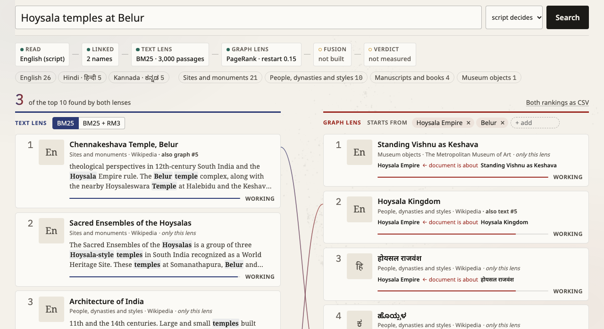
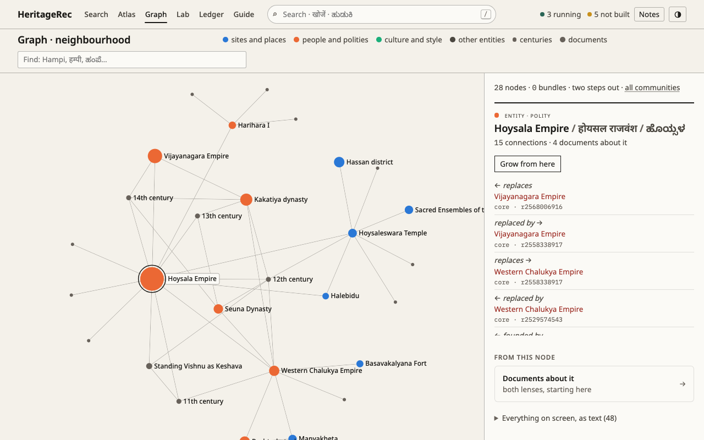
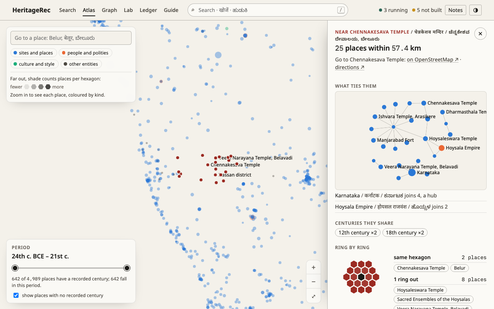

# HeritageRec

Ask the archive, in Hindi, about the Mughal fort at Agra (मुगल किला आगरा), and the text search quietly starts
looking for every passage that says *if*.



Lucene's Hindi stemmer cuts आगरा (Agra) and अगर ("if") down to the same stem, so a search that reads words
can't tell the city from the conjunction. Wikidata can: Agra is one item, with one identifier, in English, Hindi
and Kannada alike, joined by recorded facts to the places, people and periods around it.

HeritageRec is a study of that difference. It asks one question, in the open and with every step on show:

> **When people search for India's heritage, in English, Hindi or Kannada, does following a graph of facts find
> better documents than reading the words?**

The answer isn't known yet, and this repository is built so that, when it is, anyone can check how it was reached.

## One question, four ways of looking at it

The interface puts every question through the same four doors, and each door shows what it is doing.



Press *Another question* and all four doors move together. For the Hindi question about Agra, the fourth door
shows the stemmer's mistake as it happens:



**Search** reads a question twice. The text lens (BM25 over the documents' own words) and the graph lens
(Personalised PageRank, starting from the entities the question names) rank side by side. A thread joins any
document both of them found. *Working* opens the arithmetic behind every rank, and the step strip says which
parts aren't built yet, instead of pretending.



**Graph** opens any entity's neighbourhood two steps out, coloured by kind. Hubs such as a century or a whole
country are folded into counted bundles, never drawn whole.



**Atlas** answers "what is near here, and what ties it together?". Far out, it shows places as counts per
hexagon; closer in, each place appears, coloured by kind. Click one to see its neighbours, the facts that join
them, the centuries they share, and a way to get there.



**Lab** is where the system tries to break itself, run live each time the page opens. **Ledger** traces every
number on the site to the file that produced it and the commit that built it.

## What is known, and what is not yet

| | State |
| --- | --- |
| The archive | Built and frozen per version. Documents from Wikipedia (en, hi, kn), The Met, the Cleveland Museum of Art, the Art Institute of Chicago, the Wellcome Collection and the Internet Archive. Every count lives in the generated [data card](docs/data_card.md). |
| The knowledge graph | Built from Wikidata statements only, never from text similarity, so "graph against text" is a clean comparison. Statistics are in [`results/graph/core_v1.md`](results/graph/core_v1.md). |
| The text lens and the graph lens | Running: BM25 and BM25+RM3 per language; PageRank from linked entities. |
| Dense retrieval, fusion, the reranker, learning to rank | Code in progress, no runs yet: each is marked *not built* wherever it would appear. |
| The benchmark | 200 questions written from descriptions of who is searching and why, curated by hand, 40 of them in Hindi or Kannada. Being made now; the test half stays sealed until the analysis plan is frozen. |
| **The verdict** | **None yet.** No number about which lens is better will appear anywhere until the benchmark is judged and every result can be rebuilt from a tagged commit. |

The study is also auditing its own blind spot: it only knows heritage that Wikidata already describes. A sample
of official monument lists (ASI, Karnataka, Madhya Pradesh, UNESCO) is being matched against Wikidata by hand. The
results will be reported by how well each place is covered, so the paper can say where the graph's help stops
([decision 0031](docs/decisions/0031-coverage-and-selection-bias.md)).

## The rules it keeps

- **Every number is read from a file a script wrote.** Nothing is typed in by hand, on the site or in the paper.
- **Every choice has a record.** [`docs/decisions/`](docs/decisions/) holds one file per design decision, with
  the options weighed and why one won. [`docs/data_notes.md`](docs/data_notes.md) logs every hand change and
  every rule the data forced.
- **Raw before clean.** Every API response is saved untouched before it is used, so a rebuild makes no requests
  and gives a byte-identical snapshot.
- **Nothing synthetic in the archive.** No generated or machine-translated documents. The benchmark's questions
  are written by a model from searcher descriptions, then curated by hand, and that is disclosed wherever they
  are used.
- **A model's judgement is checked by a person.** Relevance is labelled by an open-weight LLM, then checked
  against human labels on a held-out set, with the agreement reported.
- **Not built means not built.** A missing part says so, with its reason, rather than showing a placeholder.

## Run it

You need Python 3.12+ with [uv](https://docs.astral.sh/uv/), Node.js with npm, and a Java 21 JDK for the search
indexes (set `JAVA_HOME` in `.env`).

```bash
git clone https://github.com/azzs11/heritagerec.git
cd heritagerec
uv sync
cp .env.example .env              # set CONTACT_EMAIL: Wikimedia asks API clients to identify themselves

uv run python -m server           # the interface's server, on http://127.0.0.1:8000
cd web && npm ci && npm run dev   # the interface, on http://localhost:3000
```

To rebuild the archive from scratch, run `bash scripts/build_corpus.sh`. A first run downloads from the public
APIs and takes several hours; later runs replay the saved responses. Re-downloading later gives a different
archive (articles and catalogues change), so the frozen snapshot, not a fresh run, is the reference version.

Check it with `uv run --group dev pytest tests/` and, in `web/`, `npm test` and `npm run e2e`. The end-to-end
suite runs every page at desktop and phone width against the real data and fails on any serious or critical
accessibility violation (axe).

## Where things are

| Path | What it holds |
| --- | --- |
| `src/corpus/` | The archive: entity lists, collectors, gazetteer, linking, snapshot, data card |
| `src/graph/`, `src/graph_retrieval/` | The Wikidata graph, and PageRank with the query linker |
| `src/retrieval/` | BM25 and BM25+RM3 per language, dense baselines, reciprocal rank fusion |
| `src/queries/` | The benchmark's information-need grid, generation, curation, split and coverage tiers |
| `src/benchmark/` | The judge's prompt, pools, human validation, evaluation (ir-measures), the tier analysis |
| `src/coverage_audit/` | Official monument lists against Wikidata (decisions 0031, 0032) |
| `notebooks/` | The runs that need a GPU (Kaggle or Colab): query generation, judging, dense encoding, translation |
| `server/`, `web/` | The interface: a FastAPI server and a static Next.js site ([`web/README.md`](web/README.md)) |
| `docs/` | The [specification](docs/plan/specification.md), decision records, data card, data notes |
| `results/` | Every generated report, each naming the commit that built it |
| `legacy/` | The superseded conference version, kept for traceability and never used as evidence |

## Data availability

At the v1.0 release, the full snapshot and the raw responses go to Zenodo with a DOI, and the benchmark to
Hugging Face. The repository holds the code, the data card and the manifest (record counts and SHA-256 checksums
of the snapshot and of every raw file), so any downloaded copy can be checked against it.

## Licence

The code is released under the [Apache License 2.0](LICENSE). The documents keep the licences of their sources
(CC BY-SA 4.0, CC BY 4.0, CC0 or public domain), recorded on every record and summarised in the
[data card](docs/data_card.md). On the site, every document page offers its text and record with the licence
written in, and a ready-made citation.

## Citation

<!-- Add the paper and the Zenodo DOI here at release. -->

To be added at release.

## Authors

<!-- Confirm the author list and order with the co-authors. -->

Akchhya Singh, with Aryan Anand and the co-authors of the conference version.
